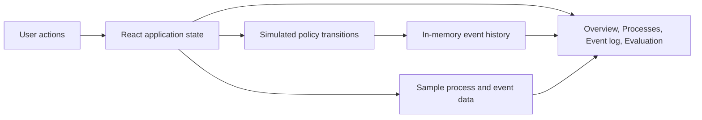

# Adaptive Resource Quarantine (ARQ)

An interactive React and TypeScript dashboard prototype for exploring **Adaptive Resource Quarantine**, a proposed operating-system mechanism for responding to abnormal process behavior. The interface is based on the project review decks and presents the idea across three stages: the problem and project concept (Review 1), the proposed control method (Review 2), and an experiment plan for measuring it (Review 3).

> **Prototype scope:** This repository contains a browser-only simulation. The process list, resource readings, anomaly scores, and events are illustrative sample data. The app does not read `/proc`, attach eBPF programs, create cgroups, send signals, or otherwise inspect or control processes on the computer running the browser.

## Project at a glance

The project explores a response between doing nothing and immediately terminating a process. In the proposed approach, the system monitors process resource behavior, compares it with a baseline, and applies progressively stronger resource limits when abnormal behavior persists. It then reassesses the process and removes restrictions when behavior returns to normal.

The dashboard demonstrates that workflow with four policy states:

| State | Meaning in the prototype |
| --- | --- |
| `NORMAL` | The process is within its expected behavior or has recovered. |
| `SUSPECT` | The score is elevated; the process is observed without applying restrictions. |
| `QUARANTINE L1` | A first, simulated restriction is applied. |
| `QUARANTINE L2` | A stronger simulated restriction is applied after a persistent anomaly. |

The sidebar displays example policy thresholds (`T1 = 3.0σ`, `T2 = 5.0σ`) and a four-cycle release window to make the proposal concrete. They are prototype values, not validated production settings. The demo button replays one CPU anomaly, escalates the sample process, and restores it to `NORMAL` after a short delay.

## Dashboard areas

- **Overview:** Summary cards, a sample resource-pressure chart, the monitored process table, a selected process panel, and recent audit events.
- **Processes:** Search and filter the sample process list by name, PID, or policy state. Select a row to inspect its telemetry and behavior summary.
- **Event log:** Review state changes recorded by the browser simulation, including the reason and the illustrative controls associated with each transition.
- **Evaluation:** Review 3's experiment matrix, proposed comparison configurations, measures to collect, and acceptance targets. Results remain marked **Not run** because this repository does not include benchmark runs or measured results.

Manual quarantine/release controls and the demo replay update local React state only. Reset restores the sample dataset and initial event list. No data is sent to a backend or persisted between page reloads.

## Architecture



The prototype is a single-page application. `src/main.tsx` mounts the React app, and `src/App.tsx` owns the page sections, sample data, state transitions, and UI components. React state is the source of truth for simulated processes, selected process, active view, event history, search/filter values, demo status, and transient notices. Components render that state and call handlers to request changes. There is no API server, database, operating-system agent, or real process-control layer.

The intended future system would need to separate privileged monitoring/enforcement from this UI. A real implementation would require a host-side service to collect resource measurements, compute or receive anomaly scores, enforce policy through an OS-specific mechanism, and publish authenticated events and metrics to a dashboard API. That integration is **not implemented here**; mechanisms shown in the review material (such as Linux `/proc`, eBPF, cgroup v2 controls, and signals) are design context only.

## File structure

```text
quarantine/
├── index.html             # Vite HTML entry point and document metadata
├── package.json           # Scripts and React/Vite/TypeScript dependencies
├── pnpm-lock.yaml         # Locked dependency graph for reproducible pnpm installs
├── pnpm-workspace.yaml    # pnpm build permission for esbuild
├── tsconfig.json          # TypeScript project references
├── tsconfig.app.json      # TypeScript settings for browser application code
├── tsconfig.node.json     # TypeScript settings for Vite configuration
├── vite.config.ts         # Vite and React plugin configuration
├── src/
│   ├── main.tsx           # React DOM bootstrap and global stylesheet import
│   ├── App.tsx            # App state, sample data, views, and UI components
│   └── styles.css         # Layout, typography, colors, responsive styles
└── README.md              # Project overview, architecture, and setup guide
```

### Main source files

- **`src/main.tsx`** creates the React root and renders `App` in strict mode. It imports the global stylesheet.
- **`src/App.tsx`** contains the application model and the screen components. The `Process` and `Event` types describe the demo records; `seedProcesses` and `initialEvents` provide the initial sample state. Components such as `Sidebar`, `WorkloadChart`, `ProcessTable`, `SelectedProcess`, `EventLog`, and `EvaluationView` build the views. `App` coordinates navigation and simulated actions.
- **`src/styles.css`** defines the visual system and responsive layout. The design takes cues from the review slides' warm neutral canvas, evergreen controls, and ochre accents.
- **`vite.config.ts`** configures Vite with the React plugin. Vite serves the app during development and creates the production bundle.
- **`tsconfig*.json`** splits TypeScript settings between browser code and Node-based build configuration.

## Technology

- React 18 for the component UI and local state
- TypeScript 5 for typed application data and handlers
- Vite 6 for local development and production builds
- `lucide-react` for interface icons
- Plain CSS for styling and responsive layouts

## Requirements

- Node.js compatible with the Vite 6 toolchain
- pnpm (recommended; the repository includes `pnpm-lock.yaml`)

## Run locally

```bash
pnpm install
pnpm dev
```

Open the local URL printed by Vite. The package scripts also support npm:

```bash
npm install
npm run dev
```

## Build and preview

Create the production bundle:

```bash
pnpm build
```

Serve the generated bundle locally:

```bash
pnpm preview
```

Vite writes production assets to `dist/`, which is generated and excluded from version control.

## Working with the demo

1. Open **Overview** and inspect the sample resource chart and process table.
2. Use **Run demo** to replay an abnormal CPU event. The `media-transcoder` sample enters `QUARANTINE L2`; after approximately 4.5 seconds, the simulation returns it to `NORMAL` and records the recovery event.
3. Select a process to open its details. The **Quarantine process** and **Release process** controls demonstrate manual state changes.
4. Use the process search and state filter to narrow the table, or open **Event log** to see the recorded transitions.
5. Open **Evaluation** for the proposed experiments and comparison set. All results are intentionally pending.
6. Use **Reset demo** to restore the initial process and event data.

## Review 3 evaluation plan

The dashboard presents five proposed workloads:

1. CPU hog beside a latency-sensitive service
2. Memory leak under rising memory pressure
3. I/O flood beside a database benchmark
4. Benign short-lived resource burst
5. Recovery after abnormal behavior returns to baseline

The suggested comparison set is no protection, kill on threshold, static cgroup cap, and adaptive quarantine. Proposed measurements include CPU, memory and swap, p95 response time, I/O performance, recovery time, false quarantines, and monitor overhead. Run these under comparable hardware, workloads, and monitoring windows, and record repeated trials and variability before drawing conclusions. **No evaluation results are included in this prototype.**

## Current limitations and next steps

- All process values, charts, scores, and events are sample/demo data.
- State is held in memory and resets on reload; there is no persistence or backend.
- Policy thresholds are illustrative and are not dynamically calculated from a rolling baseline.
- The dashboard does not implement a process collector, anomaly-scoring service, cgroup controller, eBPF monitor, or termination/recovery mechanism.
- The Evaluation page describes a plan; it does not execute workloads or claim measured outcomes.

A next implementation phase could define a host-agent/API contract, implement a least-privilege Linux collector and cgroup v2 controller, stream verified process events to the UI, persist experiment runs, and then populate the evaluation page from reproducible measurements. These steps require their own safety, permission, and platform design.
